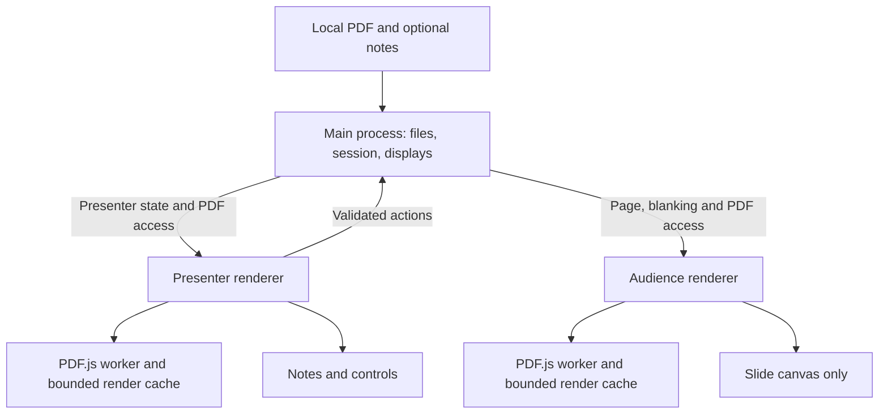

# Independent Windows/macOS PDF presenter: research and agent handoff

Research date: 2026-10-24. Status: **proposal, not an implementation**.

The existing repository remains a GPL-3.0-or-later Mac wrapper. The proposed app
should be developed independently in a new repository. **PageCue** is a suggested
name, not an approved name or a checked trademark/domain. Other brainstormed names
were Lectern, Decklight, Talkleaf, and Slidecue.

## Updated priorities: minimalist UI and native Rust options

The maintainer subsequently clarified that Présentation's minimalist interface is
the preferred design direction and questioned the weight of a browser-based stack.
They also asked to consider Rust. **This changes the weighting of the original
Electron recommendation below. No new stack has been selected or prototyped.**

Current qualitative ranking for this scope:

| Rank | Stack | Reason and main tradeoff |
|---|---|---|
| 1 | PySide6 Widgets + Qt PDF + pypdf | Lowest implementation risk for a small desktop presenter; mature window/widget tools. Ships Python/Qt and requires the applicable LGPL obligations. |
| 2 | Rust + egui/eframe + pdfium-render | Strong native Rust candidate for a compact utility UI, without a Python interpreter or browser runtime. More integration, PDFium packaging and platform QA work. |
| 3 | Rust + Iced + pdfium-render | Declarative Rust UI with a structured state/update model; worth considering for a more elaborate application. My judgment is that egui is the simpler initial fit for this custom presenter canvas. |
| 4 | Tauri + PDF.js | Rust host and web UI using the OS webview; an option if web technologies are desired, but adds Rust/JS boundaries and differing browser engines. |
| 5 | Electron + PDF.js | Can look just as minimal, but its bundled runtime is less aligned with the clarified footprint preference. |

This is a ranking of project fit, not a benchmark of binary size, speed or memory.
The first two are the actual shortlist: **Qt for the quickest dependable release;
egui for a native Rust engineering direction.** A Rust implementation is not
automatically smaller or more efficient; its renderer, feature selection, cache
and repaint scheduling matter. Native egui windows are not AppKit/WinUI widgets;
the controls are drawn by egui, so appearance needs deliberate styling.

### Concrete Rust design to prototype

- Use `eframe` for desktop lifecycle and `egui` for a presenter viewport plus a
  separate audience viewport. Native eframe supports multiple viewports. Prefer
  a deferred audience viewport so the presenter's timer does not force an audience
  repaint. Test actual monitor placement/fullscreen/DPI behavior on both OSes.
  [egui viewport documentation](https://docs.rs/egui/latest/egui/viewport/index.html)
- Use `pdfium-render` for PDF pages, attachment/annotation inspection and rendered
  bitmaps. It is a Rust wrapper around the C++ PDFium engine, not a pure-Rust PDF
  implementation. It does not bundle PDFium: ship a pinned compatible DLL/dylib
  with each release and load it from the app resources, not an arbitrary working
  directory. [pdfium-render project](https://github.com/ajrcarey/pdfium-render)
- Give one worker ownership of PDFium operations initially and communicate using
  bounded requests/results. Audit the selected bindings' threading requirements;
  do not assume independent PDF documents make native calls thread-safe.
- Render on page/scale changes, cache a bounded set of bitmaps/textures, and reuse
  them during UI redraws. Request repaint for input, completed rendering and timer
  ticks; do not rerasterize a PDF every frame or run a perpetual animation loop.
- Read `.pdfpc` using `serde_json` and newly authored format-validation code. Use
  `std::time::Instant` for the timer. Add a native file-dialog integration only as
  needed. Start without a webview, scripting runtime, or large async framework.
- Bundle appropriately licensed CJK UI fonts or a tested font-loading solution:
  PDF rendering and Chinese speaker-note rendering are separate font problems.
- Before expanding features, prove PDF rendering, Chinese notes, two windows,
  reload cancellation and a packaged application on Mac and Windows. Camera,
  movies and LaTeX animations remain separate milestones.

egui and pdfium-render offer permissive licensing choices; preserve all selected
crate, font and bundled PDFium dependency notices. This does not authorize copying
the old GPL application. See [egui's MIT license](https://github.com/emilk/egui/blob/main/LICENSE-MIT)
and [pdfium-render's license](https://github.com/ajrcarey/pdfium-render/blob/master/LICENSE.md).
For the alternative, [Iced](https://github.com/iced-rs/iced) provides an Elm-inspired
cross-platform Rust GUI model.

**Handoff adjustment:** Sections 5, 7 and 11 below describe the earlier Electron
design and are now a comparison/reference architecture, not an instruction to
implement Electron. Confirm Qt versus native Rust with the maintainer before
starting that prototype. Keep the existing functional requirements, independent
implementation boundaries and platform acceptance tests whichever stack is chosen.

## 1. Recommendation and decision context

**Recommended starting stack: Electron + TypeScript + React + PDF.js, packaged
with Electron Forge.** Use an independently authored MIT-licensed application,
subject to the maintainer choosing that license. Keep the app offline and local.
No Python service, web server, account, or cloud backend is needed.

This recommendation is an engineering judgment for these requirements:

- A research-group PDF presenter on Windows and macOS, installed by a coding agent
  from a GitHub link or downloaded as an application.
- Reliable separation of presenter notes from the projected audience view.
- PDFs produced by Typst/LaTeX, Unicode notes, overlays, a timer, and easy reload.
- Independent implementation inspired by the presentation workflow, without
  carrying Présentation's GPL implementation into the new application.
- Fast iteration by agents and maintainers, with testable behavior and reproducible
  platform-specific packages. Minimal binary size is desirable, not a stated hard
  requirement.

The licensing change removes the main reason to retain Python: reusing the old
wrapper code is no longer the plan. Electron provides native window/display APIs
and bundles Chromium and Node; PDF.js provides a controllable PDF rendering and
inspection API. Electron is MIT and PDF.js Apache-2.0. These are licenses of the
main components, **not a claim that every bundled/transitive component is MIT**.
Preserve their notices and audit the actual release dependency tree. [S3–S7]

Electron's costs are a larger runtime and ongoing Chromium/Electron updates.
No benchmark was run here, so there is no measured download size, memory advantage,
rendering speed, or guarantee of cross-platform visual identity. Its consistent
browser engine reduces one source of platform variation; fonts, GPU drivers,
display scaling, and OS window management still differ.

**Runner-up: PySide6 Widgets + Qt PDF + pypdf.** It is a good native Python design
if Python is a maintainer preference. It does not inherently force the new app
under GPL: appropriate Qt/PySide modules offer LGPL options. However, module-level
license selection and redistribution/relinking obligations must be handled. Do
not repeat the inaccurate claim that all Qt PDF releases are GPL-only. [S11–S14]

**Choose Tauri + PDF.js instead** if measured package size becomes decisive and
the team accepts Rust build tooling plus separate WebKit/WebView2 validation.
Do not switch on an assumed size or performance saving before measuring. [S15]

## 2. What was inspected and what is known

### Existing working application

The local app is a wrapper around **Présentation 3.4.0**, not a modified build of
the GTK pdfpc project. Inspection found:

- `wrapper.py` locates Présentation and executes an adapted version of its script.
- `upstream_adapter.py` checks the upstream source structure and installs notes,
  reload, and Finder-opening hooks in memory.
- `pdfpc_notes.py` parses JSON and selects a notes source using standard Python.
- `presentation_pdfpc.py` extracts PDF attachments using Apple Quartz/CoreGraphics.
- Upstream uses AppKit, Foundation, Quartz, WebKit, AVFoundation, JavaScriptCore,
  and other Apple framework bindings. Python does not make those frameworks
  available on Windows.
- The existing local app uses `/usr/bin/python3` 3.9.6. The downloaded 3.4.0 package
  has Python 3.8/3.9 PyObjC directories and declares Intel/Apple Silicon targets.
  This is package inspection, not proof of operation on every Mac.

The upstream 3.4.0 package was downloaded from its official versioned URL. Its
SHA-256, package signature, extracted app signature, adapter compatibility, and
framework imports passed on the research Mac. A new wrapper was built and checked
in a temporary directory. Existing installed apps were not replaced. The local
suite passes 51 tests, including native PDF extraction and installer failure cases.
These checks do not establish dual-monitor, camera, or Windows behavior.

The original project's published features include separate presenter/audience
views, a timer, notes, drawing, camera inset, media, links, and animation support.
That broad feature list is useful for scope planning; it is not a requirement to
replicate every feature in the first release. [S1]

### Evidence limits

This survey inspected documentation, package metadata, and the existing app. It
did **not** build Electron, Tauri, or Qt prototypes; test a Windows machine; measure
performance; inspect every dependency license; check name availability; or perform
a formal legal clean-room audit. The recommendation must pass the initial prototype
gate below before the team commits to the complete application.

## 3. Independent implementation and licensing boundaries

Présentation is GPL-3.0-or-later. Keeping and distributing the existing wrapper
under GPL is compatible with research-group sharing; GPL is not a license fee.
The desire for a different license is a reason to author a separate app, not to
rename or mechanically translate the old source. See the upstream statement and
the GPL text shipped with this repository. [S1]

For the new project:

1. Start a new repository and choose its license explicitly; MIT is recommended.
2. Implement functional requirements from this proposal and public library APIs.
   Do not copy/translate upstream or wrapper source, tests, distinctive UI artwork,
   icons, or documentation into the new app. This includes the existing notes parser
   and fixtures unless their rights holders separately authorize relicensing.
3. Use fresh application structure, original visual design, and newly authored
   synthetic test documents. Record dependency and asset provenance.
4. Give the implementing agent a fresh context with this functional proposal,
   rather than asking it to port the GPL Python files line by line.
5. Do not label the result “clean-room certified.” This research session did inspect
   GPL code. A new agent/context is a practical separation measure, not a legal
   determination of independence.

The US Copyright Office distinguishes protected program expression from functional
ideas; this supports writing to requirements rather than copying expression, but
does not settle every question about a particular derivative work or another
jurisdiction. [S2] Rewriting in another language by itself changes nothing about
whether source expression was copied.

LGPL and GPL are different choices. An MIT application can use eligible LGPL
libraries while fulfilling their conditions. Qt specifically documents notices,
corresponding library source, and replacement/relinking requirements; check every
selected module and packaged build. [S12–S13] The recommended Electron route avoids
choosing Qt's LGPL route by default; it does not remove third-party obligations.

## 4. Framework comparison

The judgments below are qualitative, not scored benchmarks.

| Candidate | Useful strengths | Costs and uncertainties | Decision for this project |
|---|---|---|---|
| Electron + TypeScript/React + PDF.js | Native multi-window/display APIs; one bundled Chromium generation; PDF rendering, attachments and annotations through one JS library; common UI tooling | Larger shipped runtime; IPC boundaries and updates need maintenance; rendering fidelity and fullscreen still need measurement | **First choice** for independent development and straightforward main-component licenses |
| PySide6 Widgets + Qt PDF + pypdf | Python; native widgets; Qt's queued PDF rendering; pypdf attachment access | LGPL/module audit; Python/native packaging; PDF rendering and metadata use two libraries | **Best Python alternative**; choose if Python matters more than a mostly permissive main stack |
| Tauri 2 + TypeScript/React + PDF.js | Native desktop windows; no bundled Chromium; similar frontend design | Rust toolchain; Windows WebView2 versus macOS WebKit; more runtime variability to test | **Size-focused alternative**, conditional on prototype results |
| Electron + built-in Chromium PDF viewer | Little initial PDF-viewer setup | Presenter overlays, exact page state, notes extraction and synchronized rendering need APIs the stock viewer UI does not provide as a stable app contract | Use explicit PDF.js integration instead of driving the built-in viewer |
| Qt/PySide + pypdfium2 | Direct PDFium access; broadly packaged Python bindings | More custom rendering/UI plumbing; PDFium lifetime/threading rules; still Qt licensing for UI | Useful fallback if Qt PDF lacks a needed feature, not a second default renderer |
| PyMuPDF + a Python GUI | Broad PDF manipulation/rendering facilities | AGPL or commercial licensing conflicts with the chosen default licensing direction | Do not add casually; revisit only with an explicit licensing decision [S16] |
| Fork native GTK pdfpc | Existing presenter features and documented Windows build route | GPL implementation, Vala/GTK dependency stack, different UI | Valid if keeping GPL, not the proposed independent permissive app [S17] |

For PDF-only data handling, pypdf is not a raster renderer; it complements a renderer.
pypdf documents attachment enumeration and duplicate filenames. pypdfium2 wraps
PDFium and ships its own dependency notices. Neither provides a presenter UI.
[S14, S18]

### Why React, and why not a Python backend?

React is optional, not a PDF dependency. It is recommended for maintaining
presenter controls, notes, dialogs and accessible UI as the app grows. Canvas
rendering stays outside frequent React reconciliation. A small TypeScript-only UI
would also be viable; do not add Redux or a second state framework initially.

There is no operation in the first release that requires Python. A Python service
would add a runtime, process lifecycle, IPC and packaging work without a clear
benefit. Reimplement the small notes format reader in TypeScript from the format
requirements and new tests. Do not embed the GPL parser as a sidecar workaround.

### Packaging tooling choice

Start with **Electron Forge's TypeScript + webpack template** and add React. Forge's
Vite plugin documentation currently labels that integration experimental; the
recommendation favors fewer build-system changes during the first release. [S19–S20]
If the maintainer prefers Vite, pin it and record that choice after a packaged-app
test, not just a successful development-server launch.

For a Qt alternative, evaluate Qt's own `pyside6-deploy` (Nuitka) first and PyInstaller
as another option. Qt's PyInstaller page contains a warning explicitly dated March
2021, so that text is not reliable evidence that current PyInstaller cannot package
Qt 6. Verify the selected modern versions directly. [S21–S23]

## 5. Proposed application architecture

Use two distinct native windows and an explicit application model. Start with one
open deck per process; document that limit rather than building multi-document
session management in the first version.



### Ownership

- **Main process:** selected file identity, read access, session generation,
  navigation actions, timer state, display selection, window lifecycle and reload.
  Keep filesystem access out of renderer JavaScript.
- **Presenter renderer:** current/next thumbnails, notes, timer, navigation controls,
  display picker and status. Parse/display notes here or in its dedicated worker.
- **Audience renderer:** slide and optional blanking/pointer overlay only. Never
  share a UI component that can suddenly show the presenter layout on this window.
- **PDF layer:** a small interface around PDF.js so an implementation can be
  replaced if the prototype fails. Do not invent a large plugin framework.
- **Pure domain modules:** physical-page mapping, note validation, source selection,
  timer transitions and commands. These should be testable without Electron.

Suggested new-repository layout, not files implemented in this repository:

```text
src/main/            # session, displays, file access, application lifecycle
src/preload/         # narrow typed IPC bridge
src/domain/          # notes, navigation, timer; no OS or UI imports
src/pdf/             # PDF.js loading, rendering, metadata adapter
src/renderer/        # presenter and audience entry points, components, styles
tests/fixtures/     # newly authored PDFs and notes with provenance
scripts/            # doctor, install-local, release checks
docs/               # architecture, compatibility, release evidence
```

Electron's `screen` API enumerates displays and reports display changes. Its
BrowserWindow API controls placement and fullscreen. Those APIs make this design
possible; they do not establish how well a particular projector/Spaces configuration
will behave. Persist a preference with a fallback, not an assumption that display
index 1 always means the projector. [S5–S6]

### State and rendering invariants

- Store page identity internally as zero-based physical page index. Adapt to
  PDF.js's one-based page API at one boundary. Logical page labels are display text.
- Every open/reload increments a document generation. Every render result carries
  that generation and its page index; discard stale results after rapid navigation.
- Never paint into the same canvas concurrently. Cancel obsolete render tasks and
  swap in a completed surface. Keep the audience on the last completed page until
  the selected new page is ready; show pending status to the presenter.
- On reload, open and validate a complete new document before swapping generations.
  If the replacement file is incomplete or corrupt, retain the old presentation.
  Clamp the current physical page if the deck becomes shorter.
- Use viewport size and device-pixel ratio for rendering. Prefetch only nearby pages
  and bound the cache by estimated bytes. A 3840×2160 RGBA bitmap alone is about
  31.6 MiB; caching hundreds of full-size pages is unacceptable.
- Each renderer may initially have its own PDF.js document/worker for simplicity.
  Measure duplicated memory before introducing shared bitmap transport. Do not
  claim that sharing a JavaScript object between processes is free.
- Use a monotonic clock for elapsed time. UI refresh frequency does not determine
  elapsed time. Define pause/resume, sleep/wake and reload behavior in tests.
- When a display disappears, leave fullscreen safely and return controls to a
  visible screen. A single-display machine remains useful for rehearsal.

PDF.js supplies page rendering, annotations, attachment and document APIs, but
exact method signatures must be checked against the pinned release. The cited API
pages are draft documentation and can move ahead of a packaged version. [S7–S8]

### Local-content boundaries

Use `contextIsolation: true`, renderer sandboxing, and no Node integration in
renderers. Expose a typed allowlist of actions, not generic filesystem or shell
execution. Validate the sender and payload of each privileged IPC operation. Load
packaged UI only. Notes are plain text, never executable HTML. External links open
only after an intentional user action under a defined URL policy. These choices
follow Electron's guidance and are relevant because PDFs and notes are input files.
[S9]

Do not enable arbitrary PDF JavaScript or automatically run embedded files. A
future media feature must not turn a PDF attachment into a general executable.
Treat byte/count/time limits as application controls, not proof that the underlying
PDF parser cannot allocate memory during decompression. Worker cancellation and
failure recovery need actual tests with malformed inputs.

Keep notes out of audience IPC projections and visual components. The original PDF
may itself contain attachments/annotations, so this separation is about preventing
accidental presentation disclosure, not hiding data from someone with the PDF.

## 6. Product scope and notes compatibility

### First usable release

1. Open a PDF through a file picker, drag/drop, or a path argument. Retain offline
   functionality after installation and restart.
2. Show current/next page and notes to the presenter; show the current page alone
   in the audience window, with fit-to-screen letterboxing.
3. Provide previous/next, first/last, go-to-page, blackout, timer pause/reset,
   display selection/swap, fullscreen and explicit reload.
4. Read sidecar and embedded format-2 `.pdfpc` notes, including Unicode and multiple
   physical overlay pages with the same logical slide label.
5. Package and smoke-test on Windows x64 and macOS arm64; add macOS x64 only when
   the lab needs it and the chosen runtime supports the declared minimum OS.
6. Provide a truthful agent installation runbook and diagnosis command.

Use normal keyboard events while either app window is active; global hotkeys are
not required. Choose original, discoverable shortcuts and test them with common
presentation clickers. The initial release does not need to mimic every upstream
binding or screen arrangement.

### Notes behavior to specify and test independently

The desired interchange data is an object with integer `pdfpcFormat: 2` and a
`pages` array. Each relevant entry has integer `idx` and string `note`. Indices refer
to physical pages, not displayed labels. Create new examples/fixtures for the new
implementation; do not copy existing test code.

Recommended compatibility policy:

- Missing notes are ordinary. Invalid optional notes should not prevent PDF viewing.
- Keep notes plain text in version one; preserve Unicode and line breaks.
- Reject invalid top-level format/version; skip malformed entries with a diagnostic
  that does not log note contents. Define the treatment of duplicates explicitly.
- Use the adjacent file obtained by replacing the final PDF extension with `.pdfpc`.
  Do not search unrelated directories or guess by modification timestamps.
- Give valid embedded notes priority over the sidecar. An intentionally empty valid
  embedded notes document should not revive stale sidecar notes.
- Existing PDF text annotations can take precedence on their pages. Extract note
  text without showing annotation popups or comment icons on the audience view.
- When several embedded candidates exist, use a deterministic documented order and
  expose the chosen source in presenter diagnostics. PDF.js may not preserve the
  same ordering as Apple's extraction; exact source-selection parity needs fixtures.
- Out-of-range indices cannot repair a stale PDF/notes pairing. Show a useful
  presenter diagnostic and recommend exporting both together.
- Put limits on note bytes, entries and attachment candidates. Check both declared
  and actual sizes where available. Attachment filenames are metadata, not paths to
  extract blindly. Avoid automatically materializing unrelated embedded media.

Do not import pdfpc timer/navigation/hidden-slide metadata until its semantics have
been separately specified. Basic timer support is application state, not a claim
of complete `.pdfpc` compatibility.

### Deferred features and why

| Feature | Why it is a separate milestone |
|---|---|
| Beamer slides with notes in a second page region | Requires explicit crop/layout rules; the first release should report unsupported layouts rather than silently guessing |
| Markdown notes | Requires an agreed rendering dialect and handling of links/images; plain text already meets the core need |
| Ink, whiteboard, spotlight | Requires input coordinates stable across DPI, resizing, and rotation; start with a simple pointer later |
| Camera overlay and recording | Permissions, device lifecycle and media testing on both platforms |
| Embedded movies and legacy PDF multimedia annotations | Extracting attachment bytes does not provide codec support, synchronization or PDF multimedia semantics |
| LaTeX `animate`, PDF JavaScript and page transitions | Not delivered automatically by a PDF raster renderer; arbitrary PDF script execution is excluded |
| Automatic file watching | Must survive atomic replacement, partial writes and bursts; explicit reload should be reliable first |
| Linux, Windows ARM, remote control, cloud sync | Outside the currently requested platform and sharing scope |

## 7. Prototype gate and staged implementation

### Phase 0 — evidence before commitment

In the **new** repository, build the smallest Electron/PDF.js spike that:

- Opens two windows, renders a real PDF page in each, selects a monitor, and enters
  and leaves fullscreen on Windows and macOS.
- Displays independently authored Chinese/math/vector/image fixtures without network
  access. Includes an embedded notes fixture and a sidecar fixture.
- Renders the next page without blocking controls and discards an obsolete render
  when rapidly navigating or reloading.
- Produces a packaged application that starts on a machine without development
  tools. Confirm PDF.js workers, fonts/CMaps and any required WASM assets are bundled.
- Records package size, startup, page-render times, memory and exact runtime versions.

If a blocker appears, compare the **same fixtures and tasks** in PySide6/Qt PDF or
Tauri before changing the decision. A tiny proof is enough; do not build three full
applications. Report what was observed and which acceptance checks remain pending.

### Phase 1 — useful presenter

Implement the independent domain layer, two windows, navigation, notes precedence,
timer and explicit reload. Add unit/integration checks as those behaviors are
implemented. Include a first-run display picker and readable keyboard help.

### Phase 2 — dependable packages and installation

Create reproducible native builds and CI on each supported OS. Commit lockfiles,
runtime version constraints, packaging configuration and fixture provenance. Add
`doctor` and installation scripts. Test upgrading an existing app without deleting
preferences or changing the default PDF handler.

### Phase 3 — only justified additional features

Collect actual group feedback, then add pointer/ink, crop layouts, media or camera
one feature at a time. Each feature needs a dependency/license review and platform
acceptance cases. Do not promise full Présentation feature parity as part of phase 1.

No calendar estimate is attached: prototype results, feature scope, access to Windows
hardware and manual testing dominate the uncertainty. Agents can generate code and
run automation, but they cannot establish physical projector reliability without
the appropriate test environment.

## 8. Validation matrix and release criteria

| Area | Required evidence |
|---|---|
| Notes | New tests for Unicode, empty sources, invalid JSON, duplicate entries, out-of-range pages, embedded/sidecar precedence, annotation priority and overlay labels |
| Rendering | Visually inspect math, CJK, embedded fonts, vectors, raster images, transparency, rotated pages and varied page sizes on both target OSes |
| Reload | Atomic file replacement, temporary invalid file, shorter PDF, changed notes, rapid navigation during reload; original files remain unchanged |
| Displays | One screen; extended two screens; projector on either side/negative coordinates; mixed DPI; connect/disconnect; sleep/wake; macOS Spaces/fullscreen; Windows scaling |
| Audience separation | Screenshots and IPC/component assertions show no presenter notes, thumbnails, dialogs or developer errors on the audience window |
| Input | Keyboard and common clicker events, focus in notes, external links, window activation and exiting fullscreen |
| Packaging | Launch packaged build offline on a clean machine, including workers/fonts; no developer Python/Node required; paths with spaces and Unicode |
| Installation | Repeat install, update, uninstall, failure rollback, unsupported OS, missing runtime, blocked security approval and managed-device limitations |
| Resources | Measure RSS and bitmap cache after repeated navigation/reload; no monotonic growth caused by unreleased documents/canvases |

Provisional usability targets, **not measured claims**: cached next-page display
within 100 ms at the 95th percentile, responsive controls during uncached rendering,
and no visible blank-frame flash on a cached page turn. Record hardware, resolution,
PDF corpus and measurement method. Establish practical startup/memory/package-size
budgets after the spike instead of selecting attractive but unsupported numbers.

Use unit tests for pure state/data behavior and a small Electron automation suite
for real windows, screenshots, reload and packaging smoke tests. Playwright's
Electron support is explicitly experimental, so pin it and keep critical test
logic separate from that adapter. Virtual displays and CI screenshots do not replace
physical-monitor testing. [S24]

## 9. Agent-oriented installation design for the future app

The desired user request is:

> Install https://github.com/OWNER/NEW-APP on this computer, following its README
> and AGENTS.md, and verify that it opens a sample presentation.

That repository does not exist as part of this proposal. The current repository's
installation command installs the GPL Mac wrapper only.

For the new app, make the agent runbook deterministic:

1. Detect OS/architecture and check the declared support matrix.
2. Prefer a matching versioned release artifact and its checksum when available.
3. Otherwise clone to an unused directory, use the pinned Node/toolchain version,
   install from the lockfile, test, package and install per-user. Never overwrite
   an edited checkout to simplify installation.
4. Verify executable identity/version and the included synthetic fixture. Distinguish
   dependency checks, automated GUI checks and manual dual-screen checks.
5. Print installed paths, update/uninstall steps, logs and any user-action blockers.

Use a local installer written in Node so the runtime already required to build can
also install; no Python dependency is needed. Proposed commands such as `npm run
doctor`, `npm run install:local`, and `npm run smoke` must be implemented and tested
before appearing as working instructions in that project's README.

On macOS, local builds need no paid Apple account, but source installation is **not
a guaranteed Gatekeeper bypass**. Downloaded applications may need the user's
Open Anyway approval; signing/notarization can be added for public releases. On
Windows, unsigned packages may likewise encounter OS or institutional policy.
An agent must not promise zero user interaction or disable system protections to
meet an installation slogan. [S25]

Build macOS and Windows artifacts on their own OS runners, test them there, and
state the architecture explicitly. Start with a zipped `.app` and a Windows ZIP of
the packaged directory; conventional installers can follow. Preserve Electron's
third-party license files in releases. Package/runtime binaries belong in releases,
not normal Git source history. [S26]

## 10. Version observations and documentation pitfalls

These were metadata observations during research, not a validated lockfile or
recommended automatic upgrade policy:

| Package | Registry version observed | Relevant metadata |
|---|---|---|
| Electron | 45.0.0 | MIT; npm package requires Node >=22.12.0 |
| pdfjs-dist | 6.4.299 | Apache-2.0; Node >=22.13.0 or >=24 |
| Electron Forge CLI | 8.0.1 | MIT; Node >=22.13.0 |
| TypeScript | 7.0.2 | Apache-2.0 |
| React | 19.3.1 | MIT |
| Tauri JS API | 2.12.4 | MIT OR Apache-2.0 |
| PySide6 | 6.12.0 | Python >=3.10,<3.16; observed Mac wheel targets macOS 14+; Windows x64/ARM wheels listed |
| pypdf | 6.21.2 | BSD-3-Clause; Python >=3.9 |
| pypdfium2 | 5.14.0 | Binding and bundled dependency licenses; Python >=3.6; Mac wheels observed for macOS 13+ |
| PyInstaller | 6.22.3 | GPL with a distribution exception; do not confuse its tooling license with a requirement to GPL every packaged app |

Registry sources: npm package metadata and PyPI JSON endpoints [S27–S28]. Resolve
and test a mutually compatible set in phase 0; a package's `engines` declaration
does not establish every OS minimum or plugin compatibility. Pin an actively
supported Node release satisfying all requirements. Do not fetch `latest` on every
student install.

Two research pitfalls worth retaining:

- The unversioned Qt PDF licensing URL redirected to a development snapshot during
  this survey. The cited Qt 6.8 licensing page is a stable historical reference,
  not proof of every later module's terms. Inspect the exact wheel/source release.
- Qt's PyInstaller documentation includes an old Qt 6 support warning. Its date
  matters; do not repeat that warning as a current finding without verification.

## 11. Handoff prompt for Opus

> Design and implement an independent Windows/macOS PDF presenter in a new
> repository. Read this proposal for requirements and research; do not copy,
> translate, or import Présentation or the GPL wrapper implementation/tests/assets.
> Use an original UI and new synthetic fixtures. Confirm the new app name and
> license with the maintainer. Start with the Electron + TypeScript + React +
> PDF.js prototype gate and record its actual results before building the full UI.
> Keep the existing Mac app untouched. Deliver the core presenter scope,
> reproducible native packages, and an agent-readable installation runbook.
> Distinguish implemented features, tested platforms, untested hardware and
> unresolved blockers. Do not claim Windows or dual-monitor validation without
> running those checks. If a gate fails, explain the evidence and evaluate the
> named alternatives on the same tasks rather than silently expanding scope.

## 12. Primary-source register

All links were consulted during the survey unless specifically identified as a
registry endpoint queried programmatically. This section records evidence, not
endorsement. Versioned package contents remain the authority for an actual release.

- **S1:** [Présentation project, license and features](https://iihm.imag.fr/blanch/software/osx-presentation/).
- **S2:** [US Copyright Office Circular 61: computer programs](https://www.copyright.gov/circs/circ61.pdf).
- **S3:** [Electron license](https://github.com/electron/electron/blob/main/LICENSE).
- **S4:** [PDF.js license](https://github.com/mozilla/pdf.js/blob/master/LICENSE).
- **S5:** [Electron screen API](https://www.electronjs.org/docs/latest/api/screen).
- **S6:** [Electron BrowserWindow API](https://www.electronjs.org/docs/latest/api/browser-window).
- **S7:** [PDF.js document API](https://mozilla.github.io/pdf.js/api/draft/module-pdfjsLib-PDFDocumentProxy.html).
- **S8:** [PDF.js page API](https://mozilla.github.io/pdf.js/api/draft/module-pdfjsLib-PDFPageProxy.html).
- **S9:** [Electron security guidance](https://www.electronjs.org/docs/latest/tutorial/security).
- **S10:** [Qt queued PDF page renderer](https://doc.qt.io/qt-6.8/qpdfpagerenderer.html).
- **S11:** [Qt PDF 6.8 licensing](https://doc.qt.io/qt-6.8/qtpdf-licensing.html).
- **S12:** [Qt for Python licenses](https://doc.qt.io/qtforpython-6/licenses.html).
- **S13:** [Qt's LGPL obligations guidance](https://www.qt.io/development/open-source-lgpl-obligations).
- **S14:** [pypdf attachment API](https://pypdf.readthedocs.io/en/stable/user/handle-attachments.html).
- **S15:** [Tauri webview differences](https://v2.tauri.app/reference/webview-versions/) and [window customization](https://tauri.app/learn/window-customization/).
- **S16:** [PyMuPDF licensing](https://pymupdf.readthedocs.io/en/latest/about.html).
- **S17:** [GTK pdfpc project and Windows compilation](https://github.com/pdfpc/pdfpc/).
- **S18:** [pypdfium2 project and dependencies](https://github.com/pypdfium2-team/pypdfium2).
- **S19:** [Forge TypeScript/webpack template](https://www.electronforge.io/templates/typescript-+-webpack-template).
- **S20:** [Forge Vite integration status](https://www.electronforge.io/config/plugins/vite).
- **S21:** [Qt deployment options](https://doc.qt.io/qtforpython-6/deployment/index.html).
- **S22:** [pyside6-deploy](https://doc.qt.io/qtforpython-6/deployment/deployment-pyside6-deploy.html).
- **S23:** [Qt's dated PyInstaller page](https://doc.qt.io/qtforpython-6/deployment/deployment-pyinstaller.html) and [PyInstaller operation](https://pyinstaller.org/en/stable/operating-mode.html).
- **S24:** [Playwright Electron automation and experimental status](https://playwright.dev/docs/api/class-electron).
- **S25:** [Apple opening/notarization guidance](https://support.apple.com/en-us/102445).
- **S26:** [Electron application distribution](https://www.electronjs.org/docs/latest/tutorial/application-distribution).
- **S27:** npm registry metadata: [Electron](https://registry.npmjs.org/electron/latest), [PDF.js](https://registry.npmjs.org/pdfjs-dist/latest), [Forge](https://registry.npmjs.org/@electron-forge/cli/latest), [TypeScript](https://registry.npmjs.org/typescript/latest), [React](https://registry.npmjs.org/react/latest), [Tauri API](https://registry.npmjs.org/@tauri-apps/api/latest).
- **S28:** PyPI metadata: [PySide6](https://pypi.org/pypi/PySide6/json), [pypdf](https://pypi.org/pypi/pypdf/json), [pypdfium2](https://pypi.org/pypi/pypdfium2/json), [PyInstaller](https://pypi.org/pypi/pyinstaller/json).
